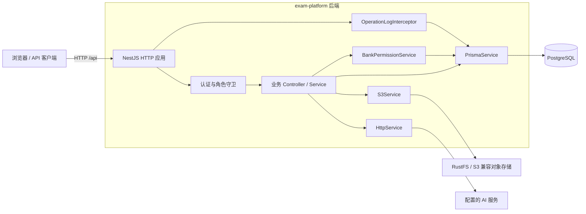
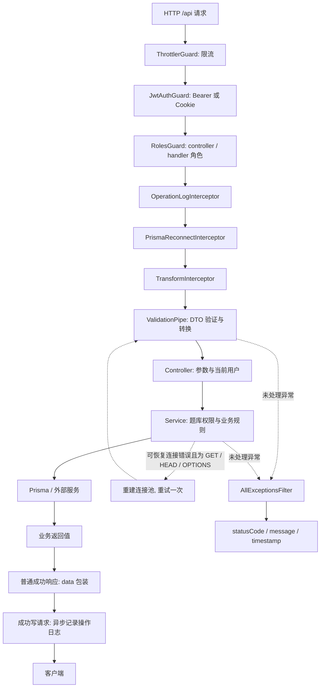
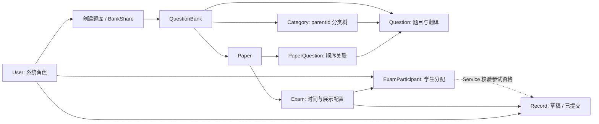

# 系统架构

[返回文档导航](README.md)

## 系统组成

本仓库是一个 NestJS 单体 HTTP 后端. 业务数据由 Prisma 6 访问 PostgreSQL, 文件内容存储于 S3 兼容服务, AI 功能通过 HTTP 调用配置的模型服务. 浏览器和其他 API 客户端位于仓库之外.

依据: [AppModule](../src/app.module.ts), [PrismaService](../src/prisma/prisma.service.ts), [S3Service](../src/files/s3.service.ts), [AiService](../src/ai/ai.service.ts). 当前没有独立前端, 消息队列, 后台任务调度或独立判题执行服务.

## 请求与响应链路

图中实线是主要处理阶段, 响应沿拦截器返回. 守卫和其他阶段抛出的未处理异常也交给全局异常过滤器. 配置与注册顺序见 [main.ts](../src/main.ts) 和 [AppModule](../src/app.module.ts).

- 全局限流配置为 100 次/60 秒. [AuthController](../src/auth/auth.controller.ts) 在控制器级覆盖为 5 次/60 秒, 包含 login, me, logout, 不只登录.
- [JwtAuthGuard](../src/common/guards/jwt-auth.guard.ts) 对 `@Public()` 跳过 JWT 校验, 公开接口仍经过限流. [JwtStrategy](../src/auth/jwt.strategy.ts) 优先提取 Bearer Token, 再提取 `exam_token` Cookie.
- [RolesGuard](../src/common/guards/roles.guard.ts) 检查 `@Roles()` 声明; 未声明角色不等于公开, 默认仍需 JWT. 题库权限和考试分配在 Service 中另行校验.
- DTO 启用 `whitelist`, `transform`, `forbidNonWhitelisted`, 非声明字段可能直接返回 400.
- [TransformInterceptor](../src/common/interceptors/transform.interceptor.ts) 统一普通成功响应. Excel 导出和文件下载使用 `@Res()` 直接写二进制内容.
- [OperationLogInterceptor](../src/common/interceptors/operation-log.interceptor.ts) 记录成功的 POST/PATCH/PUT/DELETE, 不记录失败请求或 GET. 日志异步写库, 写入失败只记录服务日志, 不回滚业务操作.
- [PrismaReconnectInterceptor](../src/common/interceptors/prisma-reconnect.interceptor.ts) 仅为 GET/HEAD/OPTIONS 的指定连接错误重连并重试一次. 写请求不自动重放, 详见 [数据库](database.md).

## 模块与职责

[PrismaModule](../src/prisma/prisma.module.ts) 和 [CommonModule](../src/common/common.module.ts) 为全局模块, 分别提供 PrismaService 和 BankPermissionService. 各业务服务直接访问 Prisma, 没有额外的 Repository 层.

| 模块          | 负责的能力                                   | 主要实现                                 |
| ------------- | -------------------------------------------- | ---------------------------------------- |
| Auth          | 密码校验, JWT, Cookie 登录与退出, 当前用户   | [auth/](../src/auth)                     |
| Users         | 账号创建, 列表, 更新, 删除                   | [users/](../src/users)                   |
| QuestionBanks | 题库, 分享, 公开状态, JSON 归档              | [question-banks/](../src/question-banks) |
| Categories    | 题库内分类和分类树                           | [categories/](../src/categories)         |
| Questions     | 题目, 语言内容, Excel 导入导出               | [questions/](../src/questions)           |
| Papers        | 题目顺序与试卷管理                           | [papers/](../src/papers)                 |
| Exams         | 考试时间, 试卷关联, 学生分配, showScore 配置 | [exams/](../src/exams)                   |
| Records       | 草稿, 提交, 自动判分, 成绩列表与统计         | [records/](../src/records)               |
| Practice      | 无需登录的公开题库练习和答案检查             | [practice/](../src/practice)             |
| AI            | 出题, 生成解析, 翻译草稿, 规则与 AI 组卷     | [ai/](../src/ai)                         |
| Files         | S3 内容与数据库文件元数据                    | [files/](../src/files)                   |
| Logs          | 超级管理员查询操作日志                       | [logs/](../src/logs)                     |

## 数据归属与授权边界

题库通过 `bankId` 在共享表中隔离, 不为每个题库创建数据库或 schema. 环境使用不同 schema, 详见 [数据库与 ER 图](database.md).

系统角色控制接口入口, 题库所有权/分享控制具体资源, ExamParticipant 控制学生参试. 当前 editor 和 exam_manager 在权限比较中同级, 个别删除操作只检查 viewer; 完整实际矩阵见 [业务逻辑](business-logic.md). 图中的学生分配校验是应用规则, Record 没有指向 ExamParticipant 的复合外键.

## 数据一致性与外部依赖

题库 JSON 导入在数据库事务中写入, 考试学生名单替换也使用事务. 这些保证不适用于全部写操作: 例如试卷更新先删除题目关联再更新, 文件上传/删除在 S3 与数据库之间依次执行, 没有跨服务事务或补偿队列.

AI 出题和解析会写数据库, 翻译接口只返回草稿, 规则组卷不调用外部 AI. 模型返回内容由 AiService 清理代码围栏并解析; 实际校验和计分差异见 [业务逻辑](business-logic.md).

试卷引用现有题目, 未保存独立题目快照. 题目编辑可能影响后续考试展示和判分; showScore 当前控制客户端展示约定, 后端提交响应仍含分数与答案明细. 这些是当前实现边界.

## 配置和验证入口

- 启动, 构建, 环境变量和测试命令: [开发与运行](getting-started.md).
- HTTP 路由, 参数及响应: [接口参考](api.md).
- Cookie, JSON 字符串差异和学生答题接入: [前端接入](frontend-api-doc.md).
- 数据库连接, 迁移, 外键和归档边界: [数据库](database.md).

TypeScript 使用 strict 和 node16 模块解析, 当前 package.json 未声明 ESM. 构建范围由 [tsconfig.build.json](../tsconfig.build.json) 限定为 src, 排除 test 和 spec 文件. E2E 使用独立 exam_test schema, 文档变更仅需执行格式, 链接和图表检查.
