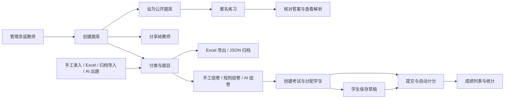
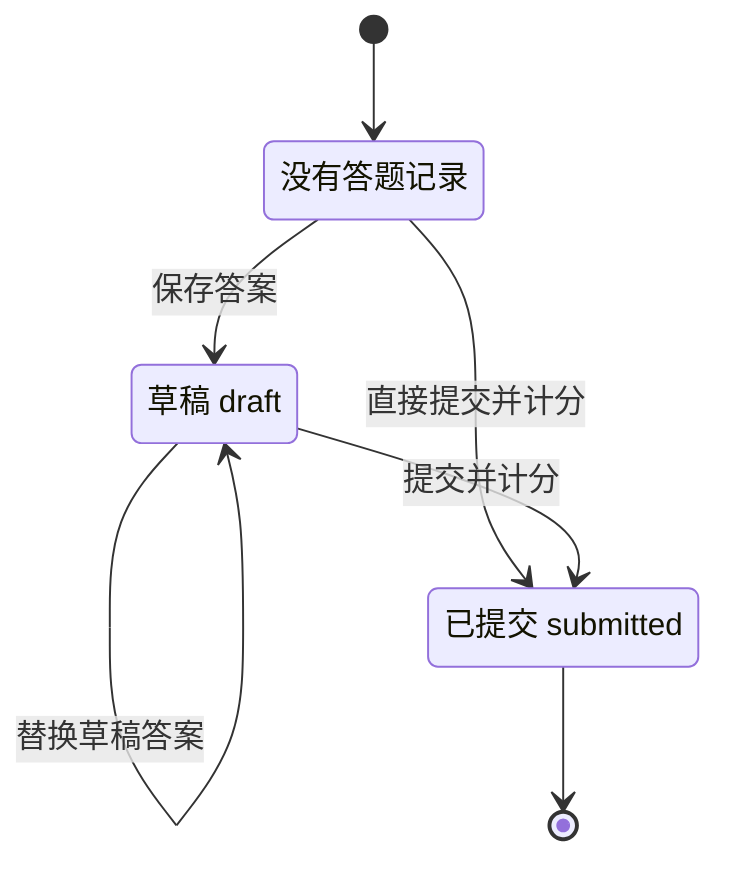
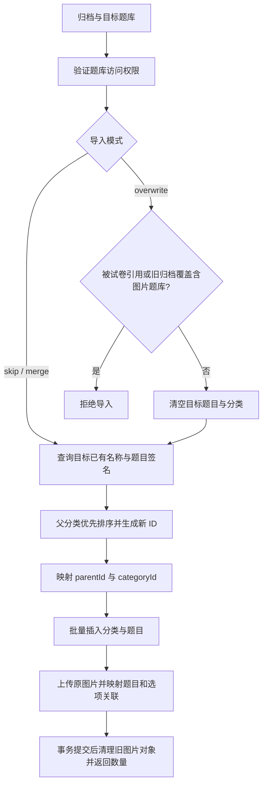

# 业务逻辑

本文依据当前 Controller, Service, DTO 和 Prisma 模型说明后端实际行为. 架构见 [architecture.md](architecture.md), 接口路径与数据格式见 [api.md](api.md), 数据关系见 [database.md](database.md).

## 业务全景

题库是内容和授权的边界. 分类, 题目和试卷直接归属题库; 考试通过试卷关联题库; 学生通过考试名单获得作答资格. 公开练习独立于考试, 不产生考试成绩记录.

对应实现: [题库](../src/question-banks/question-banks.service.ts), [试卷](../src/papers/papers.service.ts), [考试](../src/exams/exams.service.ts), [答题记录](../src/records/records.service.ts), [公开练习](../src/practice/practice.service.ts).

## 身份与权限

系统角色决定能否调用接口, 题库权限决定能否操作具体题库. 学生的考试名单是另一套授权, 被分配考试不等于获得题库访问权.

| 系统角色         | 当前职责                                                                   |
| ---------------- | -------------------------------------------------------------------------- |
| `super_admin`    | 用户增删改, 日志查询, 全部题库与教学管理, 文件管理                         |
| `question_admin` | 全部题库与教学管理, 用户列表查询, 文件管理                                 |
| `teacher`        | 创建自己的题库, 操作拥有或获分享的题库, 查询用户列表, 上传和访问自己的文件 |
| `student`        | 查询被分配的考试, 保存和恢复自己的草稿, 提交自己的答案                     |
| 未登录访问者     | 查看公开题库, 顺序练习前 50 题并核对答案, 随机和其余题目需登录             |

用户可由 `super_admin` 直接创建, 或使用其生成的一次性邀请码自助注册. 账号密码由 bcrypt 哈希存储; 用户列表不返回密码. 教师查询用户列表时返回全部用户, 不是只返回学生. 见 [用户控制器](../src/users/users.controller.ts), [用户服务](../src/users/users.service.ts), [认证服务](../src/auth/auth.service.ts).

超级管理员生成邀请码时选择系统角色, 注册账号严格使用邀请码中的角色, 不接受客户端指定角色. 注册在同一数据库事务中以 `usedAt=null` 为条件核销邀请码并创建账号, 并发使用同一码只能有一个请求成功. 用户名冲突或其他注册失败会回滚核销, 邀请码仍可使用. 注册成功后需要登录建立会话. 见 [注册 DTO](../src/auth/dto/register.dto.ts), [邀请码 DTO](../src/users/dto/create-registration-invite.dto.ts).

超级管理员可删除未使用和已使用的邀请码. 删除未使用的邀请码后无法再用它注册; 删除已使用的邀请码只移除邀请码记录, 不影响已注册账号. 删除不存在或已删除的记录返回 `404`.

### 题库分享

题库创建者成为所有者. `super_admin` 和 `question_admin` 对所有题库按 `owner` 处理. 教师的题库列表包含自己创建和获分享的题库. 只有所有者或管理员可以修改题库名称, 描述, 公开状态及分享关系. 分享对象必须是教师; 对已有分享再次提交会更新角色.

所有者或管理员可通过题库更新接口的 `createdBy` 将所有权转移给其他管理员或教师, 接收人必须存在. 转移只变更归属, 保留题库内容和分享关系; 新所有者获得所有者权限, 原所有者的访问权限按剩余角色和分享重新判断.

以下矩阵描述教师持有对应题库权限时, 当前后端的实际校验. 所有操作仍受依赖数据和其他业务校验约束.

| 操作                           | `owner` | `viewer` | `editor` | `exam_manager` |
| ------------------------------ | ------- | -------- | -------- | -------------- |
| 查看题目, 分类, 试卷, 考试     | 允许    | 允许     | 允许     | 允许           |
| Excel 导出, JSON 归档导出      | 允许    | 允许     | 允许     | 允许           |
| 创建或修改题目, 分类, 试卷     | 允许    | 拒绝     | 允许     | 允许           |
| 删除题目                       | 允许    | 拒绝     | 允许     | 允许           |
| Excel/归档导入, 所有 AI 功能   | 允许    | 拒绝     | 允许     | 允许           |
| 创建或修改考试, 查看成绩和统计 | 允许    | 拒绝     | 允许     | 允许           |
| 删除分类, 试卷, 考试           | 允许    | 允许     | 允许     | 允许           |
| 修改或删除题库, 管理分享       | 允许    | 拒绝     | 拒绝     | 拒绝           |

当前 `BankPermissionService` 将 `editor` 与 `exam_manager` 都映射为等级 `2`, 所以两者可以互相通过授权检查, 并未隔离内容编辑与考试管理权限. 分类, 试卷和考试的删除方法调用 `findOne`, 只要求 `viewer`. 这些是当前行为, 不能把角色名称当成更严格的权限保证. 见 [权限服务](../src/common/services/bank-permission.service.ts), [分类服务](../src/categories/categories.service.ts), [试卷服务](../src/papers/papers.service.ts), [考试服务](../src/exams/exams.service.ts).

## 题库内容与试卷

### 分类和题目

分类通过 `parentId` 组成树, 题目可不分配分类. 创建分类时检查父分类属于同一题库; 创建题目时检查所选分类属于同一题库. 当前更新分类的 `parentId` 和更新题目的 `categoryId` 没有重复执行这些同库检查, 分类更新也没有防环检查. 见 [分类服务](../src/categories/categories.service.ts), [题目服务](../src/questions/questions.service.ts).

题目支持单选, 多选, 判断, 填空, 简答和编程六种类型. `score` 是题目自身分值, 试卷与题目的关联仅存题序, 没有独立的试卷题目分值. 普通题目写入的难度范围为 `1-5`, 分值为正整数. 见 [题目 DTO](../src/questions/dto/create-question.dto.ts), [数据模型](../prisma/schema.prisma).

题目主语言支持 `zh` 和 `en`, 其他语言内容存入 `translations`. 题目列表和详情接受 `locale`, 有翻译则覆盖已有翻译字段, 无翻译则保留主内容. 考试计分和练习核对使用主字段 `answer`, 不按翻译答案判分. 见 [多语言工具](../src/common/utils/localize.ts), [答题记录服务](../src/records/records.service.ts), [练习服务](../src/practice/practice.service.ts).

题目图片通过 `File.questionId` 关联, 中英文共用. 题库编辑者可以上传和删除, 读取时先沿用题库权限, 公开状态或考试分配检查, 再签发 15 分钟 GET URL. 对象按 `question-banks/{bankId}/questions/{questionId}/images/` 隔离, URL 不入库. 删除未被试卷引用的题目时先清理 S3 图片和文件元数据, S3 失败时保留元数据供重试. 见 [图片服务](../src/files/question-images.service.ts).

### 组卷与分值

手工创建试卷时, 所有题目必须存在且属于试卷的题库. 题序按 `questionIds` 顺序保存. 创建时忽略请求中的 `totalScore`, 使用题目现有分值之和; 更新时如果传入 `questionIds`, 会重新计算总分并替换题目列表.

当前存在三项影响成绩解释的行为:

- 仅更新 `totalScore` 而不传 `questionIds` 时, 服务直接保存该值.
- 修改题目分值后, 已有试卷的 `totalScore` 不自动同步.
- 试卷和考试引用实时题目, 没有发布快照或冻结步骤. 提交时使用当时的题目答案与分值计分; 已提交记录中的得分明细不会自动重算.

见 [试卷服务](../src/papers/papers.service.ts), [更新试卷 DTO](../src/papers/dto/update-paper.dto.ts), [答题记录服务](../src/records/records.service.ts).

## 考试与作答

### 考试安排

创建考试必须指定现有试卷, 并满足 `startTime < endTime`. 考试没有发布状态或独立的开考动作. 更新允许修改名称, 时间, `showScore` 和学生名单, 不允许更换试卷.

`studentIds` 会去重, 每个 ID 必须对应学生. 创建时省略名单等同空名单; 更新时省略名单保持原值, 传空数组清空名单, 传数组则在事务中替换全部名单. 名单更新不清除已有答题记录. 学生列表仅显示被分配的考试, 详情也校验分配关系. 学生详情去除题目和各语言翻译中的 `answer` 与 `analysis`, 但不要求考试已经开始. 见 [考试服务](../src/exams/exams.service.ts), [考试更新 DTO](../src/exams/dto/update-exam.dto.ts).

### 答题状态

保存草稿和提交都要求学生已被分配, 且服务器当前时间位于考试起止时间内. 后端不按 `paper.duration` 建立每位学生的单独倒计时, 也没有到期自动提交任务. 读取草稿只检查分配关系和未提交状态, 不检查时间窗口.

答案是以题目 ID 为键的对象. 后端丢弃不属于当前试卷的键. 每次保存草稿用本次答案整体替换已有草稿; 提交以本次请求为准, 不自动合并旧草稿. 未作答题目按空字符串处理. 没有草稿时读取返回 `{ answers: {} }`.

同一学生在同一考试下只有一条记录. 提交会创建 `submitted` 记录或将草稿升级, 写入总分, 逐题明细和提交时间. 提交后不再允许保存草稿, 获取草稿或再次提交. 数据库的 `(examId, userId)` 唯一约束防止创建重复记录; 已有草稿升级采用先读再更新, 不应把该约束理解为所有并发提交场景的完整锁定.

见 [答题记录服务](../src/records/records.service.ts), [答题记录控制器](../src/records/records.controller.ts), [已有 E2E 场景](../test/records.e2e-spec.ts).

### 自动计分与成绩

| 题型             | 当前计分方式                                                         |
| ---------------- | -------------------------------------------------------------------- |
| 单选, 判断, 填空 | 双方去掉首尾空白后精确比较, 区分大小写, 相同得整题分值               |
| 多选             | 按英文逗号拆分, 每项去首尾空白, 排序后比较; 必须完全相同, 不给部分分 |
| 简答, 编程       | 自动得分为 `0`, 当前没有人工阅卷或代码执行判题流程                   |

提交明细包含每题的学生答案 `answer`, 标准答案 `correct`, 分值 `score` 和得分 `earned`. `Record.answers` 在草稿阶段保存答案对象的 JSON 字符串, 提交后改为逐题明细的 JSON 字符串.

`showScore` 默认 `false`, 是供客户端决定是否展示成绩的字段. 当前提交接口始终返回含 `score` 和标准答案明细的记录, 没有按 `showScore` 在后端脱敏. 学生也没有单独查询已提交成绩的接口, 提交结果是其现有成绩返回入口.

管理端成绩列表和统计只计算 `submitted` 记录. 统计返回人数, 最高分, 最低分和四舍五入为整数的平均分; 没有成绩时四项均为 `0`. 见 [答题记录服务](../src/records/records.service.ts), [考试模型](../prisma/schema.prisma).

## 公开练习

题库 `isPublic=true` 后即可匿名顺序练习前 50 题, 不需要教师分享或考试名单. 随机练习及第 51 题以后的读取和答案核对需要有效登录, 否则返回 `403` 并提示登录. 令牌无效或过期按匿名处理, 任意有效登录角色可练习完整公开题库. 练习页使用分页接口, 默认每批 50 道题; 原数组接口同样限制匿名访问范围. 顺序模式按原始题干开头的 `Question #数字` 编号数值升序, 不受翻译语言影响. 无编号题目排在最后, 相同编号及无编号题目保持 ID 升序. 登录后的分页随机模式使用本次练习的固定种子排序, 翻页和搜索复用种子, 保持题目位置一致.

分页查询先读取全题库的 ID 和标题索引, 根据登录状态确定可练习范围, 再获取当前页完整题目, 只为当前页签发图片链接. 搜索在服务端匹配可练习范围的题干、选项和翻译内容, 忽略首尾空格和英文大小写, 不搜索答案和解析. 范围限制先于匹配和分页, 保留题目在本次练习中的位置及题库总题数, 通过 `practiceTotal` 返回可练习题数. 单题读取用于刷新图片链接, 同样检查题库公开状态、题目归属和匿名访问范围.

题目查询在数据库层不选取主答案和解析, 并只保留翻译中的标题和选项. 列表, 分页和单题响应的 `isFavorite/isWrong` 只表示当前用户状态, 匿名请求均为 `false`. 核对答案时再次检查题库公开状态和题目归属, 返回正确与否, 是否可自动判分 `graded`, 标准答案及解析. 客观题比较方式与考试一致, `graded=true`; 简答和编程题返回 `correct=false, graded=false` 供自行对照, 不能按 `correct=false` 认定为错题.

### 我的错题, 收藏与练习记录

任意有效登录角色均可管理自己的练习数据, 用户 ID 取自当前 JWT, 不从请求读取. 匿名核对不保存记录. 登录核对在同一事务中新增 `PracticeAttempt` 并更新 `UserPracticeQuestion`: 每次提交累加练习次数并更新最近练习时间, 客观题答错累加历史错误次数并加入错题, 答对移出错题. 主观题保存 `correct=null` 的记录, 不加入错题, 不进入自动判分次数或正确次数. 练习数据与考试 `Record` 分开, 不累计考试成绩. 见 [练习服务](../src/practice/practice.service.ts).

收藏与取消收藏幂等, 同一用户和题目只有一条状态记录. 收藏操作不生成答题历史; 取消收藏保留错题和历史. 手动移出错题仅清除当前错题标记, 保留收藏, 累计错误次数和答题历史, 再次答错会重新收录. 个人汇总分别统计当前错题数, 收藏数, 总练习次数, 答对次数和自动判分次数, 主观题不降低客观题正确率.

个人列表与汇总只读取本人数据, 支持按题库筛选的收藏/错题列表和练习历史. 题库关闭公开后不再显示关联个人数据, 同时禁止核对和收藏, 数据在库中保留. 每次历史保存用户提交的答案, 判分结果及当时的标准答案和解析, 嵌套题目仍沿用练习内容的答案过滤规则. 删除题目时级联清理关联状态和练习历史.

从错题或收藏继续练习时, 分页接口使用 `collection=wrong|favorites`, 要求登录并先按本人的集合过滤, 再排序, 搜索和分页. `questionTotal/practiceTotal` 均对应该集合题数, `index` 为集合内位置; 固定随机种子保持集合中的题目位置一致, 搜索结果不会超出集合.

## 导入与导出

### JSON 题库归档

归档包含 `meta`, `categories`, `questions` 和 `images`, 导出版本为 `2`, 兼容版本 `1` 的旧归档. 题目的选项和翻译保留 JSON 字符串, 图片保存原文件 Base64, 大小, 文件名, MIME 和题目/选项关联. 归档不包含试卷, 考试, 成绩, 分享关系或普通文件. 可导入已有题库或通过 `/question-banks/import` 创建新题库. 新建时使用归档名称和描述, 允许另指定名称, 所有者为当前用户, 默认不公开; 新建与导入在同一事务内完成. 导入已有题库不改写目标元信息.

| 模式        | 处理方式                                                                 |
| ----------- | ------------------------------------------------------------------------ |
| `skip`      | 默认值, 跳过目标已有同名分类和同 `title + type` 的题目                   |
| `merge`     | 当前与 `skip` 完全相同, 不更新目标已有内容                               |
| `overwrite` | 若目标题目被试卷引用则拒绝; 旧版本 `1` 也不能覆盖含图片题库; 否则替换题目, 分类和附图 |

导入的删除与插入运行于同一个事务. 新分类和题目生成新 UUID, 通过映射重写关系和图片归属. 图片先校验 MIME, 文件头, 大小和选项键, 上传或数据库失败时回滚并清理本次对象. 覆盖成功提交后再清理旧对象, 避免失败时破坏原图片; 对象清理失败记录日志供运维处理. 完整导入到空题库时可重建分类层级; `skip/merge` 跳过已有分类时将源分类 ID 映射到已有分类 ID, 保留新题目和子分类的关联, 跳过题目的图片也不上传. 去重集合只含导入开始时的目标数据, 不去重归档内部同标题条目; 含图片的归档要求题目源 ID 唯一.

结果返回新增分类数, 新增题目数, `imagesImported`, 跳过数和 `errors`. 当前错误会抛出并回滚事务, 没有逐条收集导入错误的实现, 成功结果的 `errors` 为空数组. JSON 文件上限为 100 MiB, 请求体上限为 101 MiB. 见 [归档服务](../src/question-banks/bank-archive.service.ts), [归档 DTO](../src/question-banks/dto/bank-archive.dto.ts), [归档 E2E 场景](../test/bank-archive.e2e-spec.ts), [图片往返与回滚验证](../test/bank-images-transfer.e2e-spec.ts).

### Excel 题目交换

`POST /questions/import/new-bank` 支持上传 `.xlsx` 并指定题库名称, 默认创建不公开的题库, 归属当前用户. 按表内分类名称自动创建平级分类, 保留选项, 答案, 解析, 主语言, 翻译和附图. 题目批量写入, 创建与导入在同一事务内完成. 无有效题目或任一行出错时回滚整次操作并返回行错误, 图片上传失败也回滚并清理本次上传对象. Excel 不包含分类层级, 整库结构迁移应使用 JSON. 导入已有题库继续沿用逐行导入及错误摘要行为.

Excel 用于题目批量交换. 导出可限定分类; 题目数据读取首个工作表, 按固定列位置解析: 标题, 题型, 选项, 答案, 解析, 难度, 分值, 分类, 主语言, 翻译. 题型使用导出表中的中文名称, 选项和翻译列使用 JSON 字符串. 分类按目标题库已有分类名称查找, 不创建分类或还原分类树.

附图原文件以每块 30000 字符的 Base64 保存在隐藏的 `_question_images` 表, 带文件大小和题目/选项关联. 题目表增加图片数和隐藏的源 ID, 用于检测缺失图片和重建关联, 含图片时源 ID 不能重复. `题目图片` 表提供 PNG/JPEG/GIF 预览, WebP 保留原文件并显示说明. 导入同时支持直接锚定在普通题目表数据行的内嵌图片, 作为该行题干图片. 图片导出不依赖临时 URL, 无法读取原对象时明确报错.

已有题库导入逐行写入, 每行题目和图片使用同一事务, 失败会清理该行上传对象, 不回滚其他成功行, 也不去重. 图片归档的结构和内容在写入前统一校验. 返回 `total`, `success`, `failed`, `imagesImported` 和带 Excel 行号的 `errors`. 空白行会跳过, 但 `total` 仍按工作表行数减去表头计算, 因而可能不等于成功数与失败数之和. 控制器限制文件大小为 100 MiB; 虽接受旧 Excel MIME 类型, 实际解析器调用的是 `workbook.xlsx.load`, 应使用导出的 `.xlsx` 格式. 见 [题目服务](../src/questions/questions.service.ts), [题目控制器](../src/questions/questions.controller.ts).

## AI 辅助

AI 功能均要求内容编辑权限, 规则组卷除外的功能会调用已配置的外部模型服务. 模型输出仍需业务校验, 当前不同能力的持久化方式如下.

| 能力     | 当前行为                                                                                           |
| -------- | -------------------------------------------------------------------------------------------------- |
| 自动出题 | 解析模型返回的 JSON 数组, 跳过缺少标题或答案的项, 逐题直接保存; 分值固定为 `1`, 未指定难度时为 `3` |
| 生成解析 | 用题干, 选项和答案生成文本, 直接覆盖该题解析                                                       |
| 翻译题目 | 在 `zh/en` 间生成草稿, 不写数据库; 修订后通过题目更新接口保存                                      |
| 规则组卷 | 按题库, 分类, 题型和难度随机选题, 要求现有题目分值总和等于目标总分, 然后保存试卷                   |
| AI 组卷  | 将最多 100 个候选题摘要交给模型选 ID, 验证 ID 属于可用候选集合后保存试卷                           |

规则组卷 DTO 中的 `scorePerQuestion` 当前不参与计分, 不会修改题目分值; 多条规则独立抽取, 没有排除已选题目, 重叠可能造成重复题目并触发关联唯一约束. AI 组卷直接保存请求中的 `totalScore`, 未在服务端验证所选题目实际分值之和. 自动出题不保证模型严格返回请求数量, 逐题保存也没有覆盖整个批次的事务. 翻译时只将对象形式的选项加入提示词, 数组形式选项不会加入. 见 [AI 服务](../src/ai/ai.service.ts), [组卷 DTO](../src/ai/dto/smart-paper.dto.ts), [AI E2E 场景](../test/ai.e2e-spec.ts).

## 文件与操作日志

文件内容存储在 S3 兼容对象存储, 数据库保存文件名, MIME, 大小, 对象键和上传者. 上传上限为 10 MiB, 按 MIME 白名单接收图片, PDF, Office Open XML 文档, 文本和部分压缩包. 普通文件使用 `files/` 前缀, 题目图片使用独立题库/题目前缀及可空 `questionId` 外键. 通用文件接口仍由管理员查看全部文件, 教师仅可查看和下载自己上传的文件, 只有管理员可删除文件; 题目图片接口另外按题库权限读取和编辑.

上传先写对象存储再写数据库, 数据库写入失败时删除刚上传的对象, 补偿失败则记录待清理的对象键并保留原异常. 删除先删对象再删数据库, 没有跨存储事务. 见 [文件服务](../src/files/files.service.ts), [文件控制器](../src/files/files.controller.ts).

操作日志记录成功完成的 `POST`, `PATCH`, `PUT`, `DELETE` 请求, 包括草稿保存. 它保留操作者, 路径, 资源, IP 和时间, 不保存字段变更前后值. 业务失败请求不会经当前成功回调写入日志. 日志异步写入, 写入失败只记录服务器错误日志, 不回滚业务操作. 见 [日志拦截器](../src/common/interceptors/operation-log.interceptor.ts).

## 删除约束

| 对象 | 服务层显式阻止条件       | 额外行为或数据库约束                                         |
| ---- | ------------------------ | ------------------------------------------------------------ |
| 用户 | 最后一名 `super_admin`, 拥有题库, 有任意答题记录, 考试分配或题库分享 | 须先设置其他超级管理员, 转移全部题库或移除分享关系 |
| 题库 | 有题目, 分类或试卷       | 分享关系未自动删除, 仍可能触发外键限制                       |
| 分类 | 有子分类或题目           | 需先移除依赖                                                 |
| 题目 | 被任意试卷引用           | 不允许因删题破坏试卷; 通过检查后先清理题目图片, 练习状态和历史经外键级联删除 |
| 试卷 | 被考试引用               | 当前未清理 `PaperQuestion`, 有题目关联时仍会被外键限制       |
| 考试 | 有 `submitted` 记录      | 否则依次删除草稿, 分配关系, 考试; 当前这三步未封装为一个事务 |
| 文件 | 无业务引用检查           | 先删除存储对象, 再删除数据库记录                             |

用户删除的预检和删除在 Serializable 事务内执行, 防止并发删除所有超级管理员; 冲突返回 `409`, 需刷新后重试. `question_admin` 无用户管理权限, 不能作为最后一名 `super_admin` 的替代人选.

没有软删除或回收站. 显式预检通过不代表所有外键依赖已经清除. 依据: [用户服务](../src/users/users.service.ts), [题库服务](../src/question-banks/question-banks.service.ts), [分类服务](../src/categories/categories.service.ts), [题目服务](../src/questions/questions.service.ts), [试卷服务](../src/papers/papers.service.ts), [考试服务](../src/exams/exams.service.ts), [初始数据库迁移](../prisma/migrations/20260618034208_init_pg/migration.sql).
