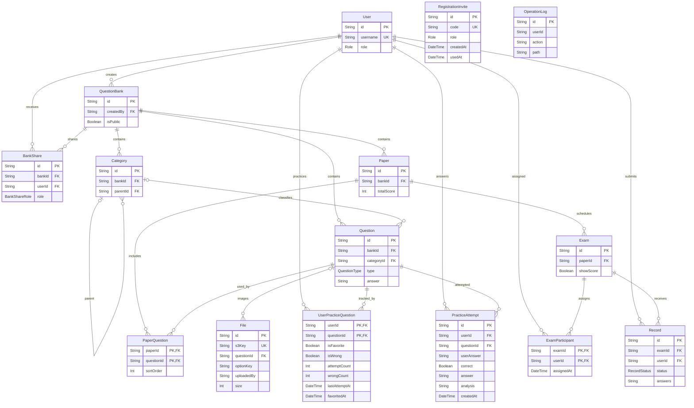

# 数据库与数据维护

后端通过 Prisma 访问 PostgreSQL. 数据结构以 [schema.prisma](../prisma/schema.prisma) 为准, 已有数据库变更保存在 [migrations](../prisma/migrations). 安装和启动步骤见 [本地开发](getting-started.md), 文档目录见 [README](README.md).

## 环境与连接

[.env.example](../.env.example) 约定同一数据库使用不同 PostgreSQL schema. 题库之间通过 `bankId` 区分, 不会为每个题库创建 schema.

| 变量                | 用途                                                      | 示例配置的 schema  |
| ------------------- | --------------------------------------------------------- | ------------------ |
| `DATABASE_URL`      | 应用运行和 Prisma CLI 使用的连接                          | `public`           |
| `DATABASE_URL_PROD` | 生产连接的配置参考, 需显式设置为运行进程的 `DATABASE_URL` | `exam_platform`    |
| `TEST_DATABASE_URL` | E2E 专用连接, 不回退到 `DATABASE_URL`                     | 必须为 `exam_test` |

运行时 [PrismaService](../src/prisma/prisma.service.ts) 将 `process.env.DATABASE_URL` 传给 PrismaClient. `DATABASE_URL_PROD` 不会自动切换应用环境. 连接示例使用 `sslmode=require`, `connection_limit=10`, `pool_timeout=10`, `connect_timeout=10`; 实际连接地址和凭据应在本地配置, 不写入文档或版本库. 连接密码中的特殊字符需要 URL 编码.

### 连接池与重连

[PrismaService](../src/prisma/prisma.service.ts) 在模块初始化时连接, 在销毁时断开, 并记录连接池生命周期日志. Prisma 本身的日志配置为 `warn` 和 `error`; 池大小和超时参数来自连接 URL.

当前恢复逻辑分为两层:

| 场景               | 实际行为                                                                                                                                                           |
| ------------------ | ------------------------------------------------------------------------------------------------------------------------------------------------------------------ |
| 启动连接失败       | 最多尝试 5 次. 可恢复错误在前 4 次失败后分别等待 1, 2, 4, 8 秒, 等待总计 15 秒, 不含每次连接耗时. 非可恢复错误立即抛出, 最终失败会使应用启动失败                   |
| HTTP 查询失败      | [PrismaReconnectInterceptor](../src/common/interceptors/prisma-reconnect.interceptor.ts) 仅对 `GET`, `HEAD`, `OPTIONS` 的可恢复错误重建连接池, 随后重试处理器 1 次 |
| 写请求失败         | 不由该拦截器重连或自动重试, 原错误继续向外传播                                                                                                                     |
| 多请求同时要求重连 | 共享同一个进行中的 Promise, 合并 `$disconnect()` 和 `$connect()`                                                                                                   |
| 重连过程失败       | 断开连接失败会记录警告并继续连接; 新连接失败则向外抛出, 不执行启动阶段的退避循环                                                                                   |

可恢复错误由 `isConnectionError` 明确限定: `PrismaClientInitializationError.errorCode` 或 `PrismaClientKnownRequestError.code` 必须属于 `P1001`, `P1002`, `P1003`, `P1008`, `P1017`. 其他错误不触发这套恢复逻辑. 拦截器在 [AppModule](../src/app.module.ts) 中注册; 未转换为 HTTP 业务异常的失败由 [全局异常过滤器](../src/common/filters/all-exceptions.filter.ts) 返回 500.

## 数据关系

下图使用 Prisma 模型名. 实线关系对应 schema 中的外键. `OperationLog.userId` 和 `File.uploadedBy` 没有用户外键; `File.questionId` 可空, 关联题目图片. 来源: [schema.prisma](../prisma/schema.prisma).

### 模型与约束

除三个复合主键关联表外, 各模型都有 `String id` 主键和 Prisma 的 `uuid()` 默认值. 数据库列类型为 `TEXT`, 因此已有数据也可能使用非 UUID 字符串, 例如 seed 的 `default` 题库. 下表的 `?` 表示可空. 来源: [schema.prisma](../prisma/schema.prisma), [初始迁移](../prisma/migrations/20260618034208_init_pg/migration.sql) 和 [个人练习迁移](../prisma/migrations/20261006000000_add_personal_practice/migration.sql).

| 模型 / 实际表名                         | 关键字段与默认值                                                                                                                       | 关系和约束                                                                                                                                    |
| --------------------------------------- | -------------------------------------------------------------------------------------------------------------------------------------- | --------------------------------------------------------------------------------------------------------------------------------------------- |
| `User` / `"User"`                       | `username`, `password`, `role=student`, `createdAt=now()`                                                                              | `username` 唯一; 关联题库所有权, 分享, 考试分配和答题记录                                                                                     |
| `QuestionBank` / `question_banks`       | `name`, `description?`, `isPublic=false`, `createdBy`, `createdAt=now()`                                                               | `createdBy` 外键到用户; 题目, 分类, 试卷和分享通过 `bankId` 关联                                                                              |
| `Category` / `categories`               | `name`, `bankId`, `parentId?`                                                                                                          | `parentId` 自关联组成分类树; 名称没有唯一约束                                                                                                 |
| `Question` / `questions`                | `title`, `type`, `options?`, `answer`, `analysis?`, `difficulty=1`, `score=1`, `locale="zh"`, `translations?`, `categoryId?`, `bankId` | 分类可空, 题库必填; 题目标题和题型组合没有数据库唯一约束                                                                                      |
| `Paper` / `papers`                      | `name`, `duration`, `totalScore`, `bankId`, `createdAt=now()`                                                                          | 题库必填; 题目经 `PaperQuestion` 关联, 考试经 `Exam.paperId` 关联                                                                             |
| `PaperQuestion` / `paper_questions`     | `paperId`, `questionId`, `sortOrder=0`                                                                                                 | 复合主键 `(paperId, questionId)`, 同一试卷不能重复关联同一题目                                                                                |
| `Exam` / `exams`                        | `name`, `paperId`, `startTime`, `endTime`, `showScore=false`, `createdAt=now()`                                                        | 没有独立 `bankId`, 通过试卷确定题库                                                                                                           |
| `ExamParticipant` / `exam_participants` | `examId`, `userId`, `assignedAt=now()`                                                                                                 | 复合主键 `(examId, userId)`, 关联考试和用户                                                                                                   |
| `Record` / `records`                    | `examId`, `userId`, `status=draft`, `score?`, `answers="{}"`, `submittedAt?`, `createdAt=now()`                                        | `(examId, userId)` 唯一; 外键分别到考试和用户, 没有到 `ExamParticipant` 的复合外键                                                            |
| `UserPracticeQuestion` / `user_practice_questions` | `userId`, `questionId`, `isFavorite=false`, `isWrong=false`, `attemptCount=0`, `wrongCount=0`, `lastAttemptAt?`, `favoritedAt?` | 复合主键 `(userId, questionId)`; 用户和题目外键均为 `ON DELETE CASCADE`; 个人集合和题目查询有索引 |
| `PracticeAttempt` / `practice_attempts` | `userId`, `questionId`, `userAnswer`, `correct?`, `answer`, `analysis?`, `createdAt=now()` | 用户和题目外键均为 `ON DELETE CASCADE`; `(userId, createdAt)` 与 `questionId` 有索引; `correct=null` 表示主观题自行对照 |
| `BankShare` / `bank_shares`             | `bankId`, `userId`, `role`, `createdAt=now()`                                                                                          | `(bankId, userId)` 唯一, 每个用户在一个题库中最多一个分享角色                                                                                 |
| `OperationLog` / `operation_logs`       | `userId?`, `username?`, `action`, `resource?`, `resourceId?`, `method`, `path`, `ip?`, `userAgent?`, `createdAt=now()`                 | `userId` 和资源字段是普通字符串, 没有外键                                                                                                     |
| `File` / `files`                        | `originalName`, `mimeType`, `size`, `s3Key`, `url?`, `uploadedBy?`, `questionId?`, `optionKey?`, `createdAt=now()`                     | `s3Key` 唯一; `uploadedBy` 无外键; `questionId` 带索引并关联题目, 删除限制为 RESTRICT; `optionKey` 为空表示题干, 否则关联选项; 内容由 S3 保存 |

`RegistrationInvite` 映射到 `registration_invites`, 字段为 `id`, 唯一的 `code`, 必填 `role`, 默认当前时间的 `createdAt` 和可空 `usedAt`. 该表没有用户外键, 删除账号不会使邀请码重新可用. [邀请码迁移](../prisma/migrations/20261006010000_add_registration_invites/migration.sql) 创建表和唯一索引; [认证服务](../src/auth/auth.service.ts) 在事务中完成条件核销和账号创建.

枚举也定义在 [schema.prisma](../prisma/schema.prisma):

| 枚举            | 取值                                                           |
| --------------- | -------------------------------------------------------------- |
| `Role`          | `super_admin`, `question_admin`, `teacher`, `student`          |
| `QuestionType`  | `single`, `multiple`, `true_false`, `fill`, `short`, `program` |
| `RecordStatus`  | `draft`, `submitted`                                           |
| `BankShareRole` | `viewer`, `editor`, `exam_manager`                             |

数据库只保证上述关系和唯一性. 例如学生身份和考试分配校验由 [ExamsService](../src/exams/exams.service.ts) 和 [RecordsService](../src/records/records.service.ts) 完成, 不属于 `Record` 表的数据库约束.

### JSON 字符串字段

这些列都是 `String` / PostgreSQL `TEXT`, 不是 JSONB. 维护数据时需要保留序列化格式.

| 字段                    | 保存内容                                                                                           | 实现                                                                                           |
| ----------------------- | -------------------------------------------------------------------------------------------------- | ---------------------------------------------------------------------------------------------- |
| `Question.options`      | 选项数据的 JSON 字符串, 可空                                                                       | [QuestionsService](../src/questions/questions.service.ts) 写入时序列化, 读取时尝试解码         |
| `Question.translations` | 按语言组织的翻译 JSON 字符串, 可空                                                                 | [localize.ts](../src/common/utils/localize.ts) 负责序列化和按语言覆盖内容                      |
| `Record.answers`        | 草稿为题目 ID 到学生答案的映射; 提交后为题目 ID 到 `{ answer, correct, score, earned }` 的阅卷明细 | [RecordsService](../src/records/records.service.ts) 在提交时替换内容并更新状态, 得分和提交时间 |

### 删除关系

[初始迁移](../prisma/migrations/20260618034208_init_pg/migration.sql) 和 [考试分配迁移](../prisma/migrations/20260625140749_add_exam_participants/migration.sql) 对必填外键使用 `ON DELETE RESTRICT`, 对 `Category.parentId` 和 `Question.categoryId` 使用 `ON DELETE SET NULL`, 外键更新均为 `CASCADE`.

因此直接删除数据库记录不会自动清理整条业务链. API 的删除校验和清理另由对应服务负责, 例如 [ExamsService.remove](../src/exams/exams.service.ts) 拒绝删除已有提交记录的考试, 否则先删除草稿和考试分配, 再删除考试. [FilesService](../src/files/files.service.ts) 删除文件时先删除 S3 对象, 再删除数据库元数据.

[个人练习迁移](../prisma/migrations/20261006000000_add_personal_practice/migration.sql) 为 `UserPracticeQuestion` 和 `PracticeAttempt` 的用户, 题目外键设置 `ON DELETE CASCADE`. 删除用户或题目会清理关联收藏, 错题状态和练习历史, 不增加原有删除阻止条件. 删除题目仍受试卷引用和图片清理规则约束.

### 个人练习数据

`UserPracticeQuestion` 保存用户与题目的当前收藏/错题标记和累计练习次数, 使用复合主键防止重复状态. `wrongCount` 是历史错误次数, 与当前错题集合数量不同; 答对或手动移出错题只清除 `isWrong`, 不重置计数. `favoritedAt` 用于收藏列表排序, 取消收藏后设为 `null`; `lastAttemptAt` 用于错题列表排序, 没有核对时为空.

`PracticeAttempt` 每次登录核对新增一条, 保存原始字符串 `userAnswer`, 判分结果及标准答案/解析快照. 客观题 `correct=true/false`, 简答和编程题为 `null`, 正确率只统计非空记录. 字段 `userAnswer/answer/analysis` 是普通文本, 不按 JSON 字符串解析. 更新练习状态与插入核对历史在同一事务中完成, 匿名核对不写入两表. 实现见 [PracticeService](../src/practice/practice.service.ts).

两表没有重复保存 `bankId`, 通过 `Question.bankId` 获取题库. 个人汇总和列表沿题目关系过滤当前仍公开的题库, 关闭公开仅影响可见性, 不删除个人数据. 练习历史不写入考试 `Record`, 不参与考试成绩. 题库 JSON 归档和 Excel 导出均不包含这些个人数据.

## 迁移与维护命令

先按 [本地开发](getting-started.md) 使用 nvm 载入 [.nvmrc](../.nvmrc) 指定的 Node, 安装依赖并配置目标 `DATABASE_URL`. 以下命令从仓库根目录执行. 数据结构变更应保存在迁移目录中.

| 操作                   | 命令                                                                          |
| ---------------------- | ----------------------------------------------------------------------------- |
| 检查 schema 定义       | `pnpm exec prisma validate`                                                   |
| 查看迁移状态           | `pnpm exec prisma migrate status`                                             |
| 应用仓库已有迁移       | `pnpm exec prisma migrate deploy`                                             |
| 开发时创建并应用新迁移 | `pnpm exec prisma migrate dev`                                                |
| 重新生成 Prisma Client | `pnpm exec prisma generate`                                                   |
| 执行种子脚本           | `pnpm exec ts-node --compiler-options '{"module":"CommonJS"}' prisma/seed.ts` |
| 打开数据编辑界面       | `pnpm exec prisma studio`                                                     |

`migrate deploy` 是 [E2E 初始化](../test/test-utils.ts) 实际使用的命令. 新增迁移和应用已有迁移是两个不同操作; 生产发布应应用已提交的迁移, 不运行会重建数据的测试初始化.

当前迁移历史:

| 迁移                                                                                                                            | 作用                                 |
| ------------------------------------------------------------------------------------------------------------------------------- | ------------------------------------ |
| [20260618034208_init_pg](../prisma/migrations/20260618034208_init_pg/migration.sql)                                             | 创建枚举, 核心业务表, 唯一索引和外键 |
| [20260623075827_add_exam_show_score](../prisma/migrations/20260623075827_add_exam_show_score/migration.sql)                     | 为考试增加 `showScore`, 默认 `false` |
| [20260625140749_add_exam_participants](../prisma/migrations/20260625140749_add_exam_participants/migration.sql)                 | 增加考试学生分配表和复合主键         |
| [20261004000000_add_question_images](../prisma/migrations/20261004000000_add_question_images/migration.sql)                     | 增加可空图片题目外键和查询索引       |
| [20261004010000_add_question_image_option_key](../prisma/migrations/20261004010000_add_question_image_option_key/migration.sql) | 增加图片关联选项的可空 key           |

### 初始数据

[seed.ts](../prisma/seed.ts) 按用户名 `admin` upsert 超级管理员, 按 ID `default` upsert 默认题库, 两处 `update` 都为空. 重跑不会修改已有账号密码或已有题库, 也不创建题目, 分类, 试卷或考试. 初始密码及 bcrypt 哈希参数以该脚本为准.

默认题库 ID `default` 不是 UUID, 而 [创建题目](../src/questions/dto/create-question.dto.ts), [分类](../src/categories/dto/create-category.dto.ts), [试卷](../src/papers/dto/create-paper.dto.ts) 的 DTO 均要求 `bankId` 为 UUID. 首次添加业务内容时应通过 `POST /api/question-banks` 创建题库, 使用接口返回的 ID. 题库创建接口见 [QuestionBanksController](../src/question-banks/question-banks.controller.ts).

## 题库逻辑归档

归档覆盖一个题库的分类和题目, 包含答案, 解析和翻译. 它不包含用户, 分享权限, 试卷, 考试, 考试分配, 答题记录, 操作日志, 文件元数据或 S3 对象, 不能用于恢复完整系统. 来源: [BankArchiveService](../src/question-banks/bank-archive.service.ts).

| 操作 | 接口                                  | 权限和数据                                                                  |
| ---- | ------------------------------------- | --------------------------------------------------------------------------- |
| 导出 | `GET /api/question-banks/:id/export`  | 控制器允许超级管理员, 题库管理员和教师; 非管理员要求题库 `viewer` 权限      |
| 导入 | `POST /api/question-banks/:id/import` | 同样的角色范围; 非管理员要求题库 `editor` 权限; 请求为 `{ archive, mode? }` |

接口定义见 [QuestionBanksController](../src/question-banks/question-banks.controller.ts), 字段定义见 [bank-archive.dto.ts](../src/question-banks/dto/bank-archive.dto.ts). 导出经过 [TransformInterceptor](../src/common/interceptors/transform.interceptor.ts), 实际 HTTP 响应为 `{ data: { meta, categories, questions } }`. 再导入时应取出响应的 `data` 作为 `archive`, 不能把整个响应原样作为归档.

`meta` 包含来源题库 ID, 名称, 可选描述, 导出时间和 `version=1`; 分类包含 `id`, `name`, `parentId`; 题目包含内容, 类型, 答案, 解析, 难度, 分值, 主语言, 翻译和分类 ID. `options` 与 `translations` 保持数据库里的 JSON 字符串. 元数据不会覆盖目标题库信息, 当前导入服务也没有按 `meta.version` 分支或拒绝未知版本. 来源: [DTO](../src/question-banks/dto/bank-archive.dto.ts) 和 [导入实现](../src/question-banks/bank-archive.service.ts).

### 导入规则与现有限制

| 模式         | 实际行为                                                                                                               |
| ------------ | ---------------------------------------------------------------------------------------------------------------------- |
| `skip`, 默认 | 根据目标库已有分类名称, 题目 `title + type` 跳过匹配条目, 其余新增                                                     |
| `merge`      | 当前实现与 `skip` 相同, 不更新已有内容                                                                                 |
| `overwrite`  | 检查目标题库题目是否存在试卷关联, 存在则拒绝; 含题目图片也拒绝以避免归档丢失图片; 否则先删除目标分类和题目, 再写入归档 |

[导入实现](../src/question-banks/bank-archive.service.ts) 在一个事务中处理清理和写入. 新增记录生成新 UUID; 分类按父子顺序处理, 通过旧 ID 到新 ID 的映射重写 `parentId` 和 `categoryId`; 分类和题目分别调用 `createMany`. 返回 `categoriesImported`, `questionsImported`, `skipped`, `errors`; 当前失败会抛错并回滚, `errors` 没有逐条收集失败的逻辑.

[归档服务](../src/question-banks/bank-archive.service.ts) 还有以下限制:

- `skip` / `merge` 仅与导入前的目标数据去重, 不把本批新记录加入去重集合. 同名分类的匹配不区分父分类.
- 被跳过的分类不会映射到目标中已有分类的 ID. 引用这类分类的新题目或子分类会得到空的 `categoryId` / `parentId`; 不能保证合并后原树和关联完整保留.
- 导出使用并行查询读取题库, 分类和题目, 没有使用事务快照. 导出期间有并发修改时, 不保证所有数据来自同一时刻.

## E2E 数据隔离

[test/test-utils.ts](../test/test-utils.ts) 封装测试数据库的初始化和清理:

1. 从 `.env` 加载配置, 保留启动 shell 中已有的非空 `TEST_DATABASE_URL`.
2. 在连接前拒绝缺少测试 URL 或 `schema` 查询参数不等于 `exam_test` 的配置.
3. 用测试 URL 创建独立 PrismaClient, 执行 `pnpm exec prisma migrate deploy`, 并将该客户端注入应用替换 `PrismaService`.
4. 每个测试套件初始化和清理时执行 `TRUNCATE ... RESTART IDENTITY CASCADE`, 清除测试业务数据. `exam_participants` 经外键级联一并清除.
5. 初始化时创建测试管理员和测试题库. 清理时断开数据库并关闭应用.

[test/jest-e2e.json](../test/jest-e2e.json) 设置 `maxWorkers: 1`, 使测试套件串行运行. 测试会清空 `exam_test` 中的数据, 该 schema 只能存放测试数据. 执行方式见 [本地开发](getting-started.md).
