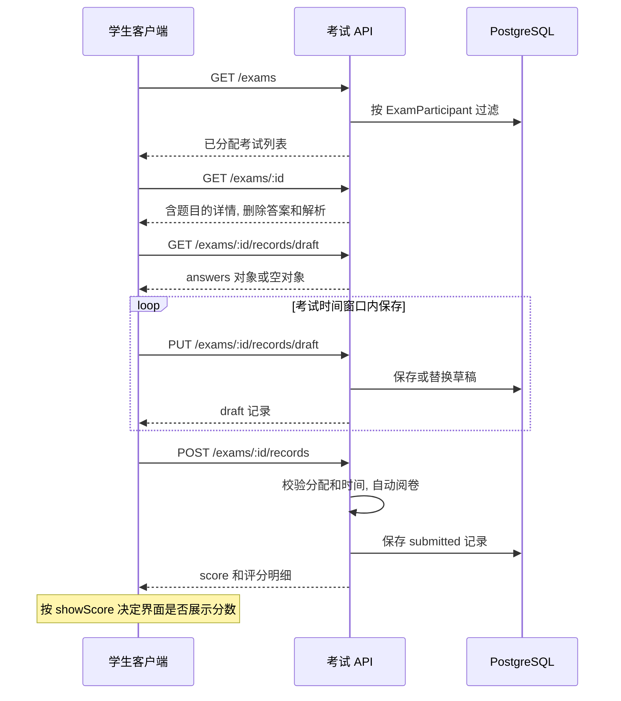

# 前端接入

本仓库交付 NestJS 后端, 未包含前端应用. 本文说明当前 API 的接入顺序和字段处理, 不约定前端框架或已完成的 UI. 全部路由与入参见 [API 接口契约](api.md), 环境搭建见 [本地开发](getting-started.md).

## 登录状态和请求配置

浏览器请求基础路径为 `/api`. 使用 Cookie 认证时, Axios 开启 `withCredentials: true`, 或 Fetch 使用 `credentials: 'include'`. 登录成功后由服务器设置 `exam_token` HttpOnly Cookie, 前端无需读取或持久化该 Cookie. 跨域来源需要列入后端 `CORS_ORIGIN`.

1. 调用 `POST /auth/login`, 使用返回的 `user: { sub, username, role }` 初始化用户状态.
2. 页面重新载入时调用 `GET /auth/me` 恢复状态. `sub` 为用户 ID. 此响应来自 token, 不保证反映签发后发生的资料或角色变更.
3. `POST /auth/logout` 清除 Cookie, 前端同步清空本地用户状态.
4. 遇到 `401` 清理失效状态并进入登录流程. `403` 表示权限不足, 不应当作登录失效. 网络错误, `400` 和 `429` 要保留调用失败状态, 不把错误分支解析成成功结果.

JWT 与 Cookie 有效期均为 4 小时, 当前没有刷新 token 接口. API 工具也可使用 Bearer token, 同时携带 Cookie 时 Bearer 优先. 登出没有撤销 Bearer token 的服务端机制. `/auth` 各处理器均覆盖为 5 次/60 秒限流, 不宜高频轮询 `/auth/me`.

生产 Cookie 为 `Secure` 和 `SameSite=None`, 需 HTTPS; 非生产为 `SameSite=Lax`. 依据: [认证控制器](../src/auth/auth.controller.ts), [认证模块](../src/auth/auth.module.ts), [JWT 策略](../src/auth/jwt.strategy.ts), [CORS 配置](../src/main.ts).

## 响应解包和表单提交

注册先由超级管理员调用 `POST /users/registration-invites` 提交目标 `role`, 取得一次性 `code`; `GET /users/registration-invites` 可查看使用状态. 注册表单只向 `POST /auth/register` 提交 `username`, `password`, `inviteCode`, 确认密码由客户端校验且不发送, 不允许提交角色. 注册成功返回脱敏用户信息, 随后调用登录接口建立会话. 邀请码无效或已使用返回 `400`, 用户名已存在返回 `409`, 失败不会消耗邀请码.

超级管理员可调用 `DELETE /users/registration-invites/:id` 删除未使用或已使用的邀请码, 成功返回 `{ data: { success: true } }`, 不存在或已删除返回 `404`. 前端应在用户确认后提交, 成功时移除列表记录, 失败时保留记录并显示接口错误. 删除后无法使用该码注册, 已注册账号不受影响.

普通成功响应外层只有一层 `{ data: T }`. 分页列表中的 `T` 自身含 `data` 数组, 因此请求库解包后仍需读取分页结果的 `data, total, page, pageSize`. 用户, 分类, 分享和公开练题列表是数组, 不能一律按分页处理.

错误响应没有成功包装, 格式为 `{ statusCode, message, timestamp }`; `message` 可能为数组. DTO 拒绝未声明字段, 更新表单应只提交该接口允许的字段, 不直接回传整个详情对象. 例如试卷更新不接收 `bankId`, 考试更新不接收 `paperId`, 题目更新不接收 `category`.

日期使用带时区的 ISO 字符串提交. 通用分页使用正整数, 每页最多 100. 成绩列表当前缺少通用分页校验, 客户端仍应遵守同样的合理范围. 依据: [启动验证配置](../src/main.ts), [分页 DTO](../src/common/dto/pagination.dto.ts), [成绩控制器](../src/records/records.controller.ts).

## JSON 字段处理

数据库把题目 `options/translations` 和记录 `answers` 保存为字符串. 当前接口没有统一的序列化层, 前端应在 API 适配层按以下返回值处理, 避免组件中反复解析.

| 接口                        | 字段返回形态                                                                              |
| --------------------------- | ----------------------------------------------------------------------------------------- |
| GET 题目列表/详情           | `options` 尝试解析为对象或数组; `translations` 尝试解析为对象, 翻译中的字符串选项也会解析 |
| POST/PATCH 题目             | `options/translations` 保持数据库 JSON 字符串或空值                                       |
| 试卷的嵌套题目              | `options/translations` 保持 JSON 字符串或空值                                             |
| 考试详情的嵌套题目          | `options` 保持 JSON 字符串; 学生版 `translations` 删除答案和解析后重新序列化为字符串      |
| AI 出题, 生成解析的题目响应 | `options/translations` 保持数据库形态                                                     |
| AI 翻译草稿                 | `translation` 为对象                                                                      |
| 公开练题列表                | `options` 尝试解析; `translations` 为只含标题/选项的对象或 `null`                         |
| 题库 JSON 归档              | `options/translations` 保留字符串, 导入时也应维持该格式                                   |
| PUT 保存草稿                | 返回完整 Record, `answers` 为 JSON 字符串                                                 |
| GET 获取草稿                | 返回 `{ answers: 对象 }`                                                                  |
| POST 交卷                   | 返回完整 Record, `answers` 为评分明细 JSON 字符串                                         |
| GET 教师成绩列表            | `answers` 尝试解析为评分明细对象                                                          |

常规题目创建/更新传入 JSON 值, 由后端负责序列化, 不预先 `JSON.stringify` 整个 `options/translations` 字段. 归档导入例外, 其 DTO 要求这两个字段为字符串. 选项当前没有统一结构约束, 现有代码可产生对象或数组; 不应假定所有来源都是 `{ A: '...', B: '...' }`.

GET 题目的解析失败可能保留原字符串, 客户端解析时也应处理空值和格式错误. 依据: [题目服务](../src/questions/questions.service.ts), [多语言工具](../src/common/utils/localize.ts), [试卷服务](../src/papers/papers.service.ts), [考试服务](../src/exams/exams.service.ts), [记录服务](../src/records/records.service.ts), [练题服务](../src/practice/practice.service.ts).

## 题库管理接入

先取题库列表并保留 `permission`, 再按选中题库加载分类, 题目, 试卷和考试. 分类列表/树, Excel 导入导出应显式传 `bankId`; 题目和试卷列表可按 `bankId` 筛选. `isPublic=true` 只开放公开练题接口, 不授予管理权限.

按钮可见性需要结合系统角色和题库权限, 最终结果仍以服务端为准. 当前 `editor/exam_manager` 为同一数值等级, 分类/试卷/考试删除只要求 `viewer`, 不能把权限名称理解为已经实现的互斥能力. 题库列表包含 `permission`, 创建/更新响应不包含该追加字段. 完整现状见 [API 权限符号](api.md#权限符号) 和各路由表.

普通试卷, 规则组卷和 AI 组卷的总分处理不同, 题目分值修改也不会自动更新试卷总分. 编辑页面应按 [试卷契约](api.md#试卷) 和 [AI 契约](api.md#ai-辅助) 展示真实结果. 删除按钮需要处理服务端引用阻止结果, 不只依赖列表计数.

用户删除遇到最后一名 `super_admin` 时, 应提示先通过用户更新接口将另一人设为 `super_admin`. 用户拥有题库时, 先为其全部题库选择接收人, 逐个调用 `PATCH /question-banks/:id` 并传 `{ createdBy: 接收人ID }`, 接收人只能是管理员或教师. 全部转移成功后再调用用户删除; 答题记录, 考试分配和题库分享仍可能阻止删除, 分享关系需先移除. 校验失败展示服务端 `400` 的 `message`, 并发冲突 `409` 时刷新用户和题库数据后重试.

## 题目图片接入

创建题目后, 使用 multipart 字段 `file` 调用 `POST /questions/:id/images`, 每次上传一张 PNG/JPEG/GIF/WebP, 最大 10 MiB. 使用 `DELETE /questions/:id/images/:imageId` 删除, 两个接口要求题库编辑权限. 不把图片字段回传到题目 PATCH.

选项附图上传时同时传 multipart 字段 `optionKey`, 对应选项对象的 key 或选项数组的 `label`, 例如 `C`. 响应 `optionKey=null` 时显示在题干后, 有值时显示在对应选项下. 不依赖文件名或数组顺序判断图片属于哪个选项.

GET 题目列表/详情, GET 试卷列表/详情, GET 考试详情和公开练题列表返回题目 `images: [{ id, originalName, mimeType, size, optionKey, url, expiresAt }]`, 没有图片则为空数组. 同一位置的图片按数组顺序显示, 中英文切换共用这些图片. `url` 可直接用于 ``, 无需附加 API 的 Bearer token; `expiresAt` 到期后重新请求当前有权限的内容接口取得新 URL, 不把签名链接长期保存. 已分配的学生从考试详情获取图片, 不需要访问管理端题目详情.

图片 URL 有效期为 15 分钟, 取得链接的人在有效期内可读取图片. 题库公开时练习接口也会签发链接; 关闭公开或取消权限不立即撤销旧链接. Excel 和 JSON 归档不包含图片, 不能用它们备份或迁移图片. 来源: [图片接口](api.md#题目图片), [图片服务](../src/files/question-images.service.ts).

## 学生考试流程

学生被分配后才能列出, 打开和答题. 创建考试的 `studentIds` 默认空数组; 更新该数组会整体替换分配关系. 学生答题应通过考试详情取得题目, 无需额外访问管理端的试卷/题目详情. 列表中的 `paper.questions` 只有关联数据, 展示答题内容应读取考试详情.

保存和提交的请求体都是 `{ answers: { 题目ID: 字符串答案 } }`. 每次草稿保存为整体替换, 应发送当前完整答案集合. 非本卷题目 key 会被过滤; 答案值应始终是字符串. 单选和判断题提交约定答案值, 多选题使用英文逗号分隔, 后端按排序后的选项字符串判分.

服务器只在 `startTime<=now<=endTime` 时接受保存和提交. 获取详情及读取草稿没有同等时间限制. `Paper.duration` 没有驱动服务端的个人倒计时, 客户端计时应以实际考试结束时间为准, 不能假定后端支持每人开考后独立计时或迟到延时.

提交成功后草稿升级为 submitted, 不能再保存或获取草稿. 没有草稿也可直接提交. 避免重复提交按钮和并行草稿请求, 并处理后端 "已提交" 错误. 当前没有学生单独查询已交试卷成绩的接口; 页面刷新后的成绩恢复不能依赖不存在的 GET 路由.

依据: [考试服务](../src/exams/exams.service.ts), [记录服务](../src/records/records.service.ts). 已有用例见 [考试 E2E](../test/exams.e2e-spec.ts), [答题记录 E2E](../test/records.e2e-spec.ts).

## 成绩显示与答案边界

`showScore=false` 可作为交卷后 UI 只显示确认信息的条件. 当前后端 POST 交卷仍返回 `score` 以及含 `correct` 标准答案的明细, 该字段并不提供服务端保密保证. 本仓库没有前端代码可证明具体展示行为已经实现.

学生考试详情删除题目主内容和翻译中的 `answer/analysis`. 公开练题列表同样去掉答案和解析, 但核对接口会立即返回参考答案. 将考试题目所在题库公开后, 同一题目可通过公开练题核对接口取得答案. 管理端题目和试卷接口是带答案的内容接口, 不应混作学生答题数据来源.

客观题全对得该题分值, 多选没有部分分. 填空按去除首尾空格后的主答案比较, 不支持同义答案或多个可选标准答案. 简答和编程题自动计 0 分, 当前没有人工阅卷和改分路由. 教师成绩列表和统计只含已提交记录, 平均分为整数.

依据: [考试答案过滤](../src/exams/exams.service.ts), [交卷和阅卷](../src/records/records.service.ts), [公开核对](../src/practice/practice.service.ts).

## 多语言和 AI

普通题目主语言为 `zh/en`. 管理端 GET 题目列表/详情支持 `locale`, 只覆盖有翻译的内容, 原 `locale` 仍代表主语言. 考试详情没有服务端 locale 参数, 客户端如使用翻译展示需自行处理安全翻译对象. 阅卷使用主语言 `answer`, 不随界面语言切换.

`POST /ai/translate/:id` 只返回草稿, 需要修订后用题目 PATCH 保存. PATCH `translations` 为整体替换, 应与要保留的其他语言合并后再发送. AI 出题直接入库, 生成解析直接更新题目, 两种组卷接口直接创建试卷; 它们都不是预览接口. 超时或网络中断后先检查结果, 不盲目重试可能已完成写入的操作.

依据: [多语言工具](../src/common/utils/localize.ts), [AI 服务](../src/ai/ai.service.ts), [AI E2E](../test/ai.e2e-spec.ts).

## 导入导出和文件

Excel 导出与文件下载返回二进制, 请求库应使用 Blob 或 ArrayBuffer, 不执行普通 JSON `data` 解包. 上传使用 multipart 字段 `file`, 由浏览器生成 multipart boundary. Excel 导入与普通文件上传各有 10 MiB 限制和各自的 MIME 白名单.

Excel 导入按行处理, 成功 HTTP 响应不表示所有行成功, 应展示 `success, failed, errors`. 题库归档导出则返回普通 JSON 包装, 需要提取 `data` 作为归档保存; 导入请求是 `{ archive: 导出的data, mode }`, 不是把外层 `{ data: ... }` 整体传回.

归档不包含试卷, 考试, 学生答题记录或分享权限, 不能替代完整数据库备份. 选择导入模式前应了解 [归档覆盖与分类映射规则](api.md#题库分享和归档). 文件列表中的 `url` 是 S3 地址, 需要受权限控制的下载时使用 `GET /files/:id`. 教师只能列出和下载本人上传的文件, 删除仅管理员可用.

依据: [题目 Excel 实现](../src/questions/questions.service.ts), [归档实现](../src/question-banks/bank-archive.service.ts), [文件控制器](../src/files/files.controller.ts), [文件服务](../src/files/files.service.ts).

## 公开练题接入

先取公开题库, 再通过 `/practice/banks/:bankId/question-pages` 按需读取题目, 默认每批 50 道. 未登录仅能顺序练习前 50 题, 有效登录后可练习全部题目及使用随机模式. 请求参数为 `mode, page, pageSize, keyword?, seed?, collection?, questionId?`, 响应的业务 `data` 为 `{ data, total, questionTotal, practiceTotal, page, pageSize, seed, initialIndex }`. 题目 `index` 从 0 开始, 表示本次练习中的位置, 不因搜索改变; `total` 为可练习范围内的匹配数量, 普通练习的 `questionTotal` 为题库总题数, `practiceTotal` 为当前用户可练习题数. 导航使用 `practiceTotal`, 小于 `questionTotal` 时提示登录后继续. 后续翻页及搜索复用首次响应的 `seed`, 保持随机顺序. 原 `/questions` 数组接口保留兼容, 同样执行匿名访问限制.

`keyword` 在后端检索当前可练习范围内的题干、选项及翻译内容, 忽略首尾空格和英文大小写. 搜索响应的 `matchingIndexes` 为匹配题目的原位置数组, 用于切题时同步搜索导航页. `mode` 默认为 `sequential`, 按原始题干开头的 `Question #数字` 编号数值升序, 无编号题目排在最后. 切换语言不改变顺序. 随机模式的位置序号与原始题号可能不同. `GET /practice/banks/:bankId/questions/:questionId` 返回单题, 可用于刷新该题图片链接而不重新加载整套题目. 匿名随机练习及超出前 50 题的单题读取和答案核对返回 `403`, 提示登录.

核对请求使用 `{ userAnswer: 字符串 }`, 不是考试提交的 `answers` 对象. 响应包含 `correct, graded, answer, analysis`; 客观题 `graded=true`, 简答和编程题固定 `correct=false, graded=false`, 展示参考答案供自行对照, 不标记为答错. 匿名核对不保存数据, 登录核对自动记录本次练习, 答错加入错题, 答对移出错题. 练习没有 locale 查询参数, 不创建考试 Record. 题库关闭公开后读取和核对返回 `404`. 依据: [练题控制器](../src/practice/practice.controller.ts), [练题服务](../src/practice/practice.service.ts).

### 登录用户的个人练习

个人接口使用现有 Cookie 或 Bearer 登录状态, 不传用户 ID, 任意有效角色均可访问. `GET /practice/mine/summary` 返回当前公开题库范围内的 `wrongCount, favoriteCount, attemptCount, correctCount, gradedCount`. 正确率按 `correctCount / gradedCount` 计算, 分母为 0 时显示无数据. `attemptCount` 包含主观题, `gradedCount` 只包含可自动判分的题目.

`GET /practice/mine/questions?collection=wrong|favorites&bankId?&page?&pageSize?` 返回分页项 `{ question, bank: { id, name }, attemptCount, wrongCount, lastAttemptAt }`. `question` 不含答案和解析, `wrongCount` 为该题历史错误次数, `lastAttemptAt` 无作答时为 `null`. `GET /practice/mine/records` 使用相同的可选题库和分页参数, 项为 `{ id, userAnswer, correct, answer, analysis, createdAt, question, bank }`; 主观题 `correct=null`, 应展示为自行对照, 历史外层答案和解析来自本次核对时的快照.

题目数组, 分页和单题的 `isFavorite/isWrong` 来自当前用户. 使用 `PUT /practice/banks/:bankId/questions/:questionId/favorite` 收藏, 使用同路径 `DELETE` 取消, 都返回 `{ isFavorite }` 并保持幂等. `DELETE /practice/mine/wrong-questions/:questionId` 手动移出错题, 返回 `{ success: true }`, 保留收藏和历史. 操作成功后刷新该题状态, 集合列表和汇总; 核对答对后也刷新错题列表.

从个人列表进入集合练习时, 为 `/practice/banks/:bankId/question-pages` 传 `collection=wrong|favorites`, 服务端只在本人的集合内分页和搜索. `questionTotal/practiceTotal` 均为本次集合题数, 从 0 开始的 `index` 对应集合内位置, 不根据完整题库数量触发登录提示. 切换集合时重新取得种子, 同一集合的后续翻页与搜索继续复用响应 `seed`. 个人接口和集合练习未登录返回 `401`; 题库关闭公开后个人列表隐藏该库, 不按历史中的题目 ID 绕过公开状态.

打开指定题目时同时传 `questionId`, 使用响应的实际 `page` 加载导航, 使用 `initialIndex` 设置当前题位置, 不假定指定题目位于第一页. 指定题不在当前集合或搜索匹配范围内返回 `404`, 页面应刷新集合并提示题目已不在当前范围.
